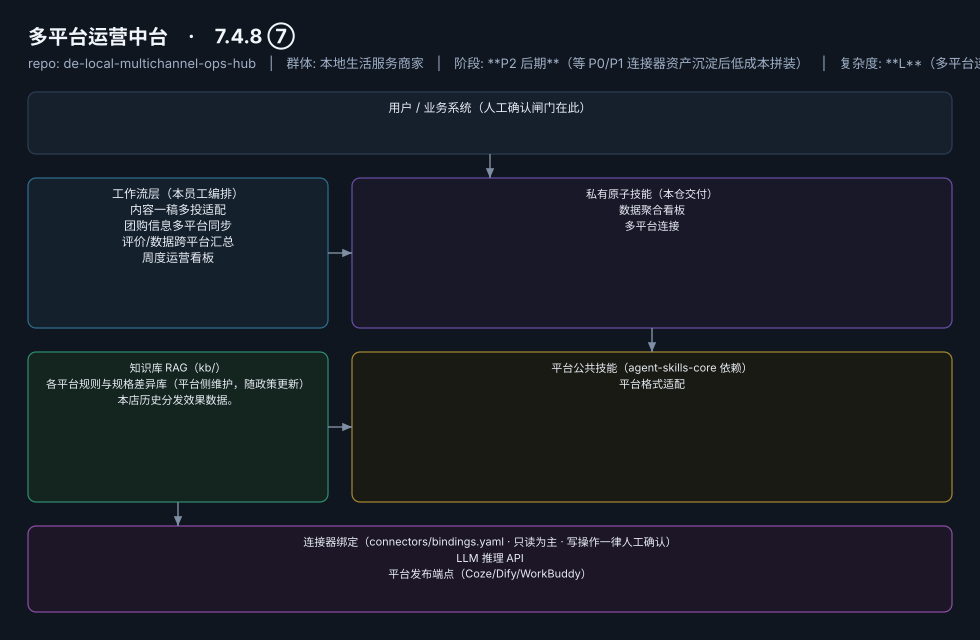

# 多平台运营中台

> 一次编辑，三平台同步的跨平台传送带
>
> **7.4.8 ⑦**　·　本地生活服务商家　·　阶段 **P2 后期**（等 P0/P1 连接器资产沉淀后低成本拼装）　·　
> 复杂度 **L**（多平台连接器矩阵）　·　50–150 元/月（据 R4 调研）；**代配置服务加成：300–600 元/次**（三平台账号授权与数据打通代办）；**不单卖，只做组合包底盘**　·　定义卡 7.4.8 ⑦



## 效果（真实执行）


*上图为**真实效果对比**，不是示意图：左栏是输入材料与要求，右栏是该次执行的产出原文，
两栏取自同一次真实执行记录。*

- 完整台账：[`reports/real-run/wf-local-hub-content-adapt.md`](reports/real-run/wf-local-hub-content-adapt.md)
- 录屏与终端回放：[`workflows/wf-local-hub-content-adapt/docs/images/`](workflows/wf-local-hub-content-adapt/docs/images/)（`08-demo-run.gif` / `08-demo-run.mp4` / `04-terminal-run.png`）
- 使用示例：[`workflows/wf-local-hub-content-adapt/docs/使用示例.md`](workflows/wf-local-hub-content-adapt/docs/使用示例.md)
> 实测判定：**通过**　·　可用度 4/5　·　编造数字 0 处　·　红线命中 0 次 / 拦截 0 次


**一句话**：已同时运营美团+抖音+小红书的进阶门店（能同步多平台的商家不足三成，据 R4 调研）

---

## 这个数字员工解决什么问题

云端定时汇总+推送；发布侧半自动。

| 项 | 内容 |
|---|---|
| 服务对象 | 已同时运营美团+抖音+小红书的进阶门店（能同步多平台的商家不足三成，据 R4 调研） |
| 可量化目标 | 三平台信息一致率 100%；单条内容多平台分发耗时 ≤10 分钟 |
| 投入产出 | 单点痛感弱，但作为组合资产把 P0 三个智能体的数据串成一盘棋，续费锁定价值大 |
| 需求依据 | D11、D02 |
| 分发渠道 | GitHub（必备）、Dify Marketplace、Coze 扣子商店、腾讯 WorkBuddy Skill 市场（工具市场型渠道为主，不做内容平台推广） |

## 30 秒上手

```bash
git clone <本仓库地址> && cd de-local-multichannel-ops-hub
pip install pyyaml
python3 tests/run.py            # 先跑一遍自检，确认环境与契约都对得上
```

试用（把 `<输入>` 换成本人真实材料）：

```text
请以「多平台运营中台」的身份，帮我跑「内容一稿多投适配」。
材料如下：<输入>
要求：只使用材料里出现过的数字，缺的写 <待填>；对外文案停在待确认状态。
```

详细接入见 [`docs/01-安装与接入.md`](docs/01-安装与接入.md)。

## 仓库结构

```text
de-local-multichannel-ops-hub/
├── employee.yaml          # 机器契约（能力清单 + 依赖锁）
├── dependencies.yaml      # 对 core 的外部依赖（含版本）
├── persona/               # 运行提示词 / 边界 / KPI
├── skills/                # 私有原子技能（2 个）
├── spec-bindings/         # 有意不公共化能力的本地绑定声明（0 个）
├── workflows/             # 本员工工作流（4 条）
├── kb/                    # 知识库 RAG 契约
├── connectors/            # 连接器绑定（只读为主，写操作人工确认）
├── docs/                  # 六类发布文档
└── tests/                 # 自动化多场景测试
```

## 私有原子技能（2）

| 技能 | slug | 复杂度 | 阶段 | 成熟度 |
|---|---|---|---|---|
| `数据聚合看板` | `data-dashboard-builder` | M | P2 | 契约完备 |
| `多平台连接` | `multichannel-connector` | M | P2 | 契约完备 |

## 平台公共技能依赖（1）

| 技能 | slug | 全平台复用员工数 |
|---|---|---|
| `平台格式适配` | `platform-format-adapter` | 6 |

> 这些技能来自 `agent-skills-core@1.0.0`，本仓库**只引用不复制**。

## Spec 绑定层（0）

（无）

> 这一族能力**有意不公共化**（与外部平台接口强绑定）。本仓不存正文，
> 只留本地绑定声明与连接器配置。

## 工作流（4）

| 工作流 | slug | 触发 | 阶段 | 调用技能数 |
|---|---|---|---|---|
| `内容一稿多投适配` | `wf-local-hub-content-adapt` | 人工（投喂单稿） | P2 | 1 |
| `团购信息多平台同步` | `wf-local-hub-groupbuy-sync` | 人工触发+定时校验 | P2 | 1 |
| `评价/数据跨平台汇总` | `wf-local-hub-data-merge` | 定时（每日） | P2 | 2 |
| `周度运营看板` | `wf-local-hub-unified-view` | 定时（每周一） | P2 | 1 |

## 知识库与连接器

- 知识库语料：['各平台规则与规格差异库（平台侧维护，随政策更新）', '本店历史分发效果数据。']
- 连接器：LLM 推理 API、平台发布端点（Coze/Dify/WorkBuddy）

## 质量与验收

| 项 | 值 |
|---|---|
| 技能文件数 | 102 |
| 多场景用例数 | 180 |
| 用例通过 | 180 |
| 验收结论 | ✅ 通过 |

完整报告：[`docs/05-验收与测试.md`](docs/05-验收与测试.md)

## 许可

专有许可，详见 [`LICENSE`](LICENSE)。
