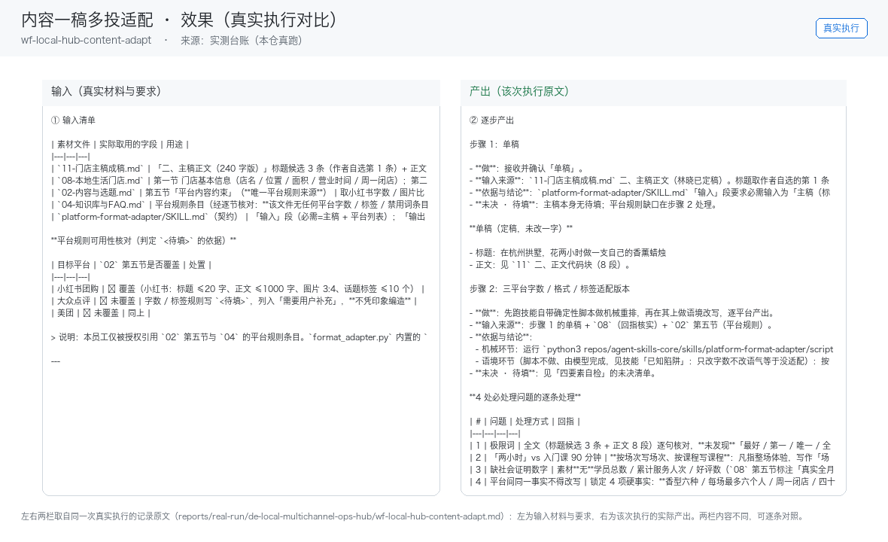

# 03 · 场景与价值

## 谁在用

已同时运营美团+抖音+小红书的进阶门店（能同步多平台的商家不足三成，据 R4 调研）

## 三个典型场景

### 场景 A：内容一稿多投适配
- **触发**：人工（投喂单稿）
- **之前**：人工从头做一遍，每次口径不一、结果不可比
- **之后**：单稿 → 三平台字数/格式/标签适配版本
- **收益**：每条内容省 30 分钟重复劳动

### 场景 B：团购信息多平台同步
- **触发**：人工触发+定时校验
- **之后**：套餐变更 → 各平台上架信息核对清单
- **收益**：避免"抖音有券美团没改"的客诉

### 场景 C：评价/数据跨平台汇总
- **触发**：定时（每日）
- **之后**：三平台评价/订单数据 → 统一面板
- **收益**：替代逐个后台切换，日省 20 分钟

## 价值构成

| 维度 | 说明 |
|---|---|
| 省时间 | 单点痛感弱，但作为组合资产把 P0 三个智能体的数据串成一盘棋，续费锁定价值大 |
| 提一致性 | 同一能力固化成技能，口径不再因人而异 |
| 降风险 | 业务红线写死在提示词里，越界即停 |
| 可审计 | 每个数字可回指输入，产出可追溯 |

## 与人工的边界

本员工**不替代决策**。它负责把重复劳动做成清单与初稿，
把决策点（要不要发、要不要改价、要不要道歉）留给人。

## 效果证据（真实执行）

**左输入 / 右产出**的对比图，取自一次真实执行（不是示意图、不是环境探测截图）：

| 证据 | 位置 |
|---|---|
| 完整台账（输入清单 + 逐步产出 + 质检 + 如实说明） | [`../reports/real-run/wf-local-hub-content-adapt.md`](../reports/real-run/wf-local-hub-content-adapt.md) |
| 效果对比图 | [`../workflows/wf-local-hub-content-adapt/docs/images/00-effect.png`](../workflows/wf-local-hub-content-adapt/docs/images/00-effect.png) |
| 终端回放 | [`../workflows/wf-local-hub-content-adapt/docs/images/04-terminal-run.png`](../workflows/wf-local-hub-content-adapt/docs/images/04-terminal-run.png) |
| 录屏（真实执行回放） | [`../workflows/wf-local-hub-content-adapt/docs/images/08-demo-run.gif`](../workflows/wf-local-hub-content-adapt/docs/images/08-demo-run.gif)　·　[`../workflows/wf-local-hub-content-adapt/docs/images/08-demo-run.mp4`](../workflows/wf-local-hub-content-adapt/docs/images/08-demo-run.mp4) |
| 使用示例（真实输入→输出） | [`../workflows/wf-local-hub-content-adapt/docs/使用示例.md`](../workflows/wf-local-hub-content-adapt/docs/使用示例.md) |

### 该次实测的判定

| 项 | 值 |
|---|---|
| 实测判定 | 通过 |
| 可用度 | 4/5 |
| 编造数字 | 0 处 |
| 红线命中 / 拦截 | 0 / 0 |
| 必需输入缺失已标注 | 5 处 |

> 该次执行用的是**模拟材料**（虚拟企业「拾光手作」）。换成你自己的材料需要重跑一遍——
> 数值纪律要求输出里每个数字都能在输入里找到出处，换材料后出处会变。
