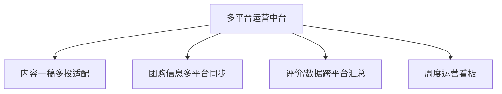

# 数字员工定义卡：多平台运营中台

> 遵循 [小班底数字员工资产规范](https://github.com/xiaobandi/digital-employee-spec) v1.0（12 主字段 + 2 扩展组）
> 本卡为人读快照，机器契约以 [`employee.yaml`](employee.yaml) 为准。

## A. 身份定义

| 字段 | 内容 |
|------|------|
| 名称 | **多平台运营中台** |
| 别名 / 旧名存档 | None |
| 一句话定位 | 一次编辑，三平台同步的跨平台传送带 |
| 目标用户 | 已同时运营美团+抖音+小红书的进阶门店（能同步多平台的商家不足三成，据 R4 调研） |
| 所属客群 | 本地生活服务商家 |
| 仓库 | `de-local-multichannel-ops-hub` |
| 定义卡编号 | 7.4.8 ⑦ |
| 版本 | 1.0.0 |
| 阶段 | **P2 后期**（等 P0/P1 连接器资产沉淀后低成本拼装） |
| 复杂度 | **L**（多平台连接器矩阵） |

## B. 角色边界（做 / 不做）

| 做 | 不做 |
|----|------|
| **做**：内容规格适配、团购信息同步、数据跨平台汇总；**不做**：不做自动发布（平台风控红线）、不做跨平台刷量 | — |

## C. 目标与 KPI

三平台信息一致率 100%；单条内容多平台分发耗时 ≤10 分钟

## D. 工程与商业属性

| 字段 | 内容 |
|------|------|
| 评分 | 19 |
| 定价 | 50–150 元/月（据 R4 调研）；**代配置服务加成：300–600 元/次**（三平台账号授权与数据打通代办）；**不单卖，只做组合包底盘** |
| 投入产出（ROI） | 单点痛感弱，但作为组合资产把 P0 三个智能体的数据串成一盘棋，续费锁定价值大 |
| 分发渠道 | GitHub（必备）、Dify Marketplace、Coze 扣子商店、腾讯 WorkBuddy Skill 市场（工具市场型渠道为主，不做内容平台推广） |

## E. System Prompt

```text
"各平台规则差异是专业壁垒；违反平台规则的批量操作请求直接拒绝"
```

> 完整运行提示词见 [`persona/system-prompt.md`](persona/system-prompt.md)。

## F. 工作流清单（4 条）



| # | 工作流 | 名称 | 触发方式 | 阶段 | 调用技能 |
|---|--------|------|---------|------|---------|
| 1 | `wf-local-hub-content-adapt` | 内容一稿多投适配 | 人工（投喂单稿） | P2 | platform-format-adapter |
| 2 | `wf-local-hub-groupbuy-sync` | 团购信息多平台同步 | 人工触发+定时校验 | P2 | multichannel-connector |
| 3 | `wf-local-hub-data-merge` | 评价/数据跨平台汇总 | 定时（每日） | P2 | multichannel-connector、data-dashboard-builder |
| 4 | `wf-local-hub-unified-view` | 周度运营看板 | 定时（每周一） | P2 | data-dashboard-builder |

**步骤链路**：`wf-local-hub-content-adapt`：单稿 → 三平台字数/格式/标签适配版本；`wf-local-hub-groupbuy-sync`：套餐变更 → 各平台上架信息核对清单；`wf-local-hub-data-merge`：三平台评价/订单数据 → 统一面板；`wf-local-hub-unified-view`：跨平台投入产出对比 → 平台侧重建议

## G. 技能清单（2 个私有）

| 技能 | 名称 | 成熟度 | 版本 |
|------|------|--------|------|
| `data-dashboard-builder` | 数据聚合看板 | contract-complete | 1.0.0 |
| `multichannel-connector` | 多平台连接 | contract-complete | 1.0.0 |

### 共享技能（挂载自公共底座）

| 技能 | 来源仓 | 版本 |
|---|---|---|
| `platform-format-adapter` | agent-skills-core | 1.0.0 |

## H. 知识库与连接器

| 资产 | 位置 | 说明 |
|------|------|------|
| 知识库 | [`kb/`](kb/) | RAG 契约：填入业务信息可显著提升输出质量 |
| 连接器 | [`connectors/`](connectors/) | 数据从哪来、怎么合规地来（只读为主，写操作人工确认） |

## I. 需求溯源

| 字段 | 内容 |
|------|------|
| 需求编号 | D11、D02 |
| 需求支持度 | 充分 |
| 证据置信度 | 中 |

## J. 可信三字段

| 字段 | 值 |
|------|-----|
| 需求支持度 | 充分 |
| 证据置信度 | 中 |
| 使用边界 | 见 B 段（做 / 不做） |

---

*本卡由 `tools/upgrade_facade.py` 依定义卡规范自动生成，请勿手工编辑；改 `employee.yaml` 后重跑即可刷新。*
