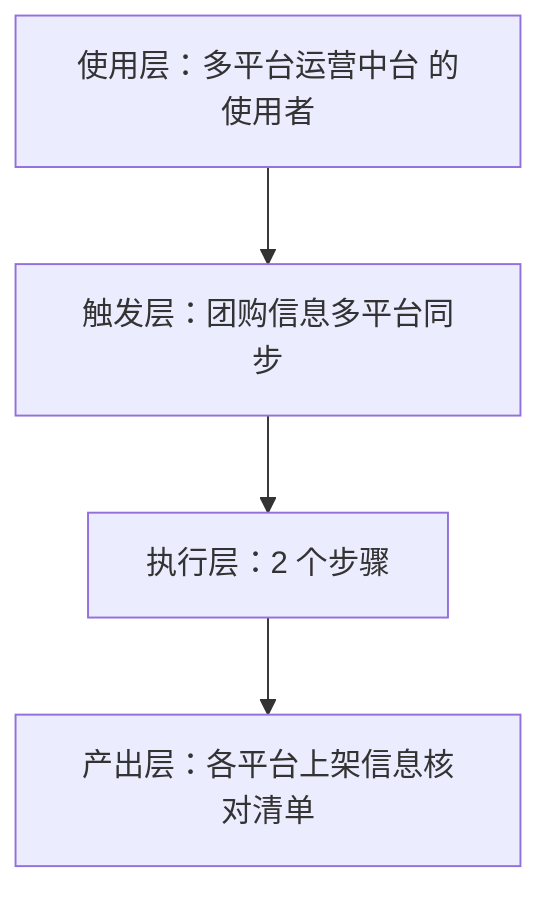
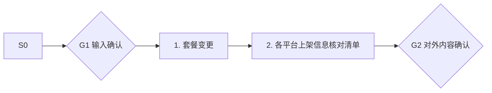

# 团购信息多平台同步 · 架构与流程图

## 本工作流的四层结构

| 层 | 内容 |
|---|---|
| 使用层 | 已同时运营美团+抖音+小红书的进阶门店（能同步多平台的商家不足三成，据 R4 调研）；员工定位：一次编辑，三平台同步的跨平台传送带 |
| 触发层 | 关键词 / 显式点名「团购信息多平台同步」；触发方式：人工触发+定时校验 |
| 执行层 | 套餐变更 → 各平台上架信息核对清单 |
| 产出层 | 各平台上架信息核对清单 |

## 执行流程

## 步骤职责表

| # | 步骤 | 承担者 | 为什么 |
|---|---|---|---|
| 1 | 套餐变更 | 模型 | 需要读懂语境，不可用固定规则替代 |
| 2 | 各平台上架信息核对清单 | 模型 | 需要读懂语境，不可用固定规则替代 |

⚠️ 尚未补齐：图中的步骤来自注册表口径，未逐条实跑校验；实跑后请同步修订本页（`发布标准.md` 第六项：通读一遍，不得出现重复填充句）。
